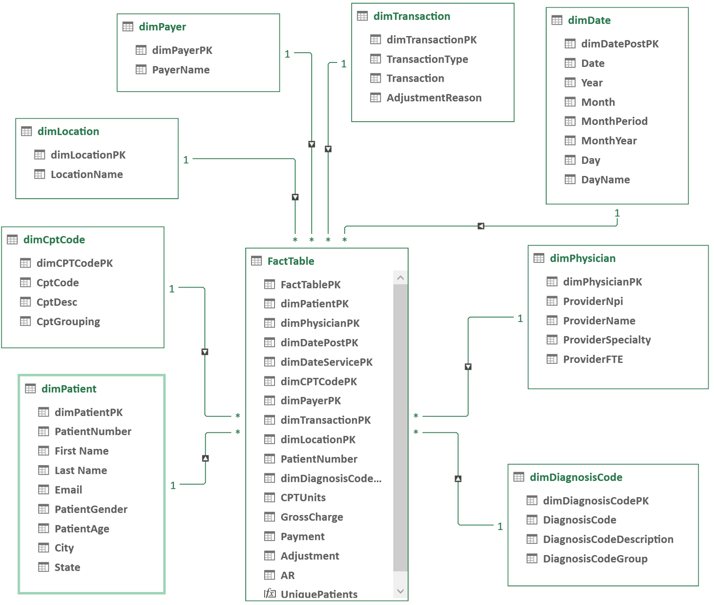

# 🏥 Healthcare Analytics SQL Project

## 📘 Overview

The **Healthcare Analytics SQL Project** is a SQL-based data analysis project focused on exploring healthcare operations, patient demographics, physician performance, and financial performance.

Using **Microsoft SQL Server**, I analyzed healthcare data to uncover insights into patient populations, clinical services, hospital operations, insurance reimbursements, and revenue cycle management.

---

## 🎯 Objectives

- Analyze patient demographics and clinical diagnosis patterns.
- Understand physician activity and healthcare service utilization.
- Evaluate hospital performance across different locations.
- Analyze insurance payments, medical charges, and reimbursements.
- Identify revenue leakage and opportunities to improve collection performance.

---

## 🧰 Tools & Technologies

- **Microsoft SQL Server** – Database querying and analysis.
- **SQL** – Data extraction, aggregation, transformation, and analysis.
- **SQL Server Management Studio (SSMS)** – Writing and executing SQL queries.

---

## 🗂️ Project Structure

The project is divided into three major analytical areas:

### 👥 Patient & Clinical Analysis

- Patient demographics and age distribution.
- Patient population and diagnosis patterns.
- Clinical service utilization.

### 🩺 Physician & Healthcare Operations

- Physician specialties and Medicare participation.
- CPT code utilization and procedure volumes.
- Physician payment trends.
- Hospital location performance.

### 💰 Financial & Revenue Cycle Analysis

- Gross Charges and collection rates.
- Insurance reimbursements and payment comparisons.
- Physician credentialing adjustments and revenue leakage.
- Net Collection Rate and Accounts Receivable analysis.
- Charge per Unit and Payment per Unit.

---

## 🔑 SQL Concepts Used

- Aggregate Functions (`COUNT`, `SUM`, `AVG`)
- Joins (`INNER JOIN`)
- Filtering (`WHERE`, `HAVING`, `LIKE`)
- Grouping and Sorting (`GROUP BY`, `ORDER BY`)
- Conditional Logic (`CASE WHEN`)
- Subqueries
- NULL Handling (`NULLIF`)
- Data Formatting (`FORMAT`, `CONCAT`)
- Date-Based Analysis
- Calculated Financial Metrics

---

## 📊 Key Metrics Analyzed

- **Gross Collection Rate (GCR)**
- **Net Collection Rate**
- **Net Charges**
- **Charge per Unit**
- **Payment per Unit**
- **Average Charge per Patient**
- **Accounts Receivable (AR)**

---

## ✅ Outcome

This project demonstrates how SQL can be used to analyze healthcare data and transform raw information into meaningful business insights.

The analysis highlights opportunities to:

- Improve revenue collection performance.
- Identify billing inefficiencies.
- Understand reimbursement patterns.
- Evaluate physician and hospital performance.
- Support data-driven decision-making across healthcare operations.

---

> 🏥💉 *"At this point, even the unpaid invoices need a next of kin!"*
