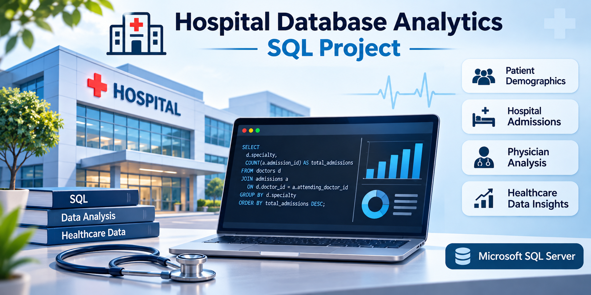
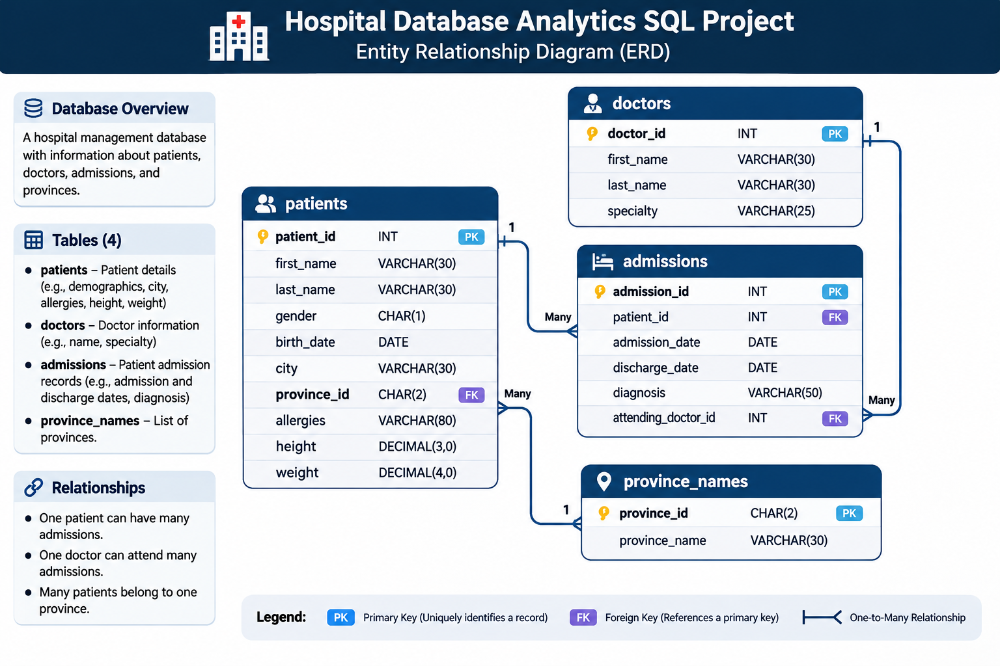

# 🏥 Hospital Database Analytics – SQL Project

## 📘 Overview

The **Hospital Database Analytics SQL Project** is a SQL-based data analysis project built using **Microsoft SQL Server** and the **Hospital Database** dataset from **SQL-Practice.com**.

Through **54 SQL questions and solutions**, this project explores patient demographics, hospital admissions, physician activity, medical diagnoses, and geographical healthcare trends to uncover meaningful insights from healthcare data while strengthening real-world SQL skills.

---

## 🎯 Objectives

- Analyze patient demographics and health-related information.
- Understand hospital admission patterns and patient visit frequency.
- Evaluate physician activity and admission distribution.
- Identify common medical diagnoses and recurring admissions.
- Explore patient distribution across cities and provinces.
- Apply SQL techniques to solve healthcare-focused business questions.

---

## 🧰 Tools & Technologies

- **Microsoft SQL Server** – Database querying and analysis
- **SQL** – Data extraction, transformation, and reporting
- **SQL Server Management Studio (SSMS)** – Query development and execution

---

## 📂 Dataset Source

This project uses the **Hospital Database** provided by **SQL-Practice.com**, a platform designed for learning SQL through practical, real-world datasets and exercises.

🔗 **Source:** https://www.sql-practice.com/

---

## 🗃️ Database Schema

The database consists of four relational tables:

| Table | Description |
|---------|-------------|
| `patients` | Patient demographics and health information |
| `admissions` | Admission, discharge, diagnosis, and physician records |
| `doctors` | Physician details and specialties |
| `province_names` | Province identifiers and names |

---

## 📊 Analysis Areas

### 👥 Patient Demographics Analysis
- Gender distribution analysis
- Age and birth-year insights
- Patient distribution by city and province
- Health-related attributes (height, weight, allergies)
- Duplicate patient record detection

### 🏥 Hospital Admissions Analysis
- Total admission volume analysis
- Daily admission trends
- Patient admission frequency
- Readmission and recurring diagnosis analysis
- Patients without admission records
- Most recent admission tracking

### 🩺 Physician & Medical Analysis
- Physician specialty analysis
- Admissions handled by individual doctors
- Physician workload evaluation
- Diagnosis-based physician analysis
- Patient and attending physician reporting

### 📈 Advanced SQL Analysis
- Conditional aggregation
- Subqueries and nested queries
- Common Table Expressions (CTEs)
- Window functions
- Data grouping and filtering
- String manipulation
- Date-based analysis
- Healthcare KPI calculations

---

## 🔑 SQL Concepts Used

- Aggregate Functions (`COUNT`, `SUM`, `AVG`, `MIN`, `MAX`)
- Joins (`INNER JOIN`, `LEFT JOIN`)
- Filtering (`WHERE`, `HAVING`, `LIKE`, `IN`, `BETWEEN`)
- Grouping & Sorting (`GROUP BY`, `ORDER BY`)
- Conditional Logic (`CASE WHEN`)
- Subqueries
- Common Table Expressions (CTEs)
- Window Functions (`LAG`)
- String Functions (`CONCAT`, `UPPER`, `LOWER`, `LEN`)
- Date Functions (`YEAR`, `MONTH`, `DAY`)
- NULL Handling
- Data Manipulation (`UPDATE`)

---

## 🔍 Key Insights Explored

- Most common patient diagnoses
- Physician admission workload distribution
- Frequent hospital visitors and readmissions
- Geographic concentration of patients
- Daily and overall admission trends
- Patients without hospitalization records
- Demographic patterns across patient groups

---

## 📁 Project Contents

- ✅ 54 SQL Questions & Solutions
- ✅ Beginner to Advanced SQL Challenges
- ✅ Healthcare Data Analysis Scenarios
- ✅ Data Cleaning & Transformation Tasks
- ✅ Business-Oriented Analytical Queries

---

## 🎓 Skills Demonstrated

This project showcases proficiency in:

- SQL Query Writing
- Data Analysis & Reporting
- Relational Database Management
- Data Aggregation & Transformation
- Problem Solving with SQL
- Healthcare Data Exploration
- Advanced Query Techniques

---

> *🏥💀 "The hospital treats patients. SQL treats my curiosity about the data!"* 
